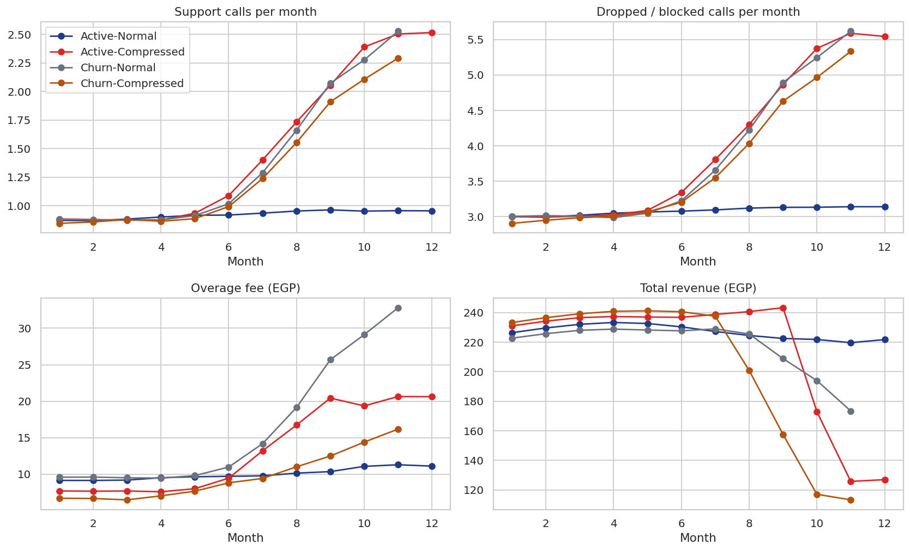
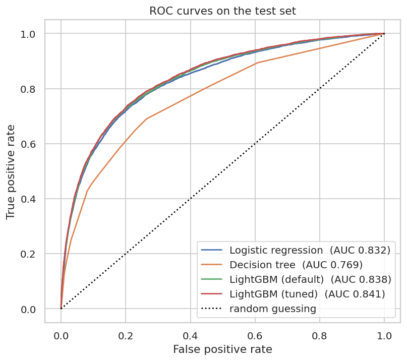
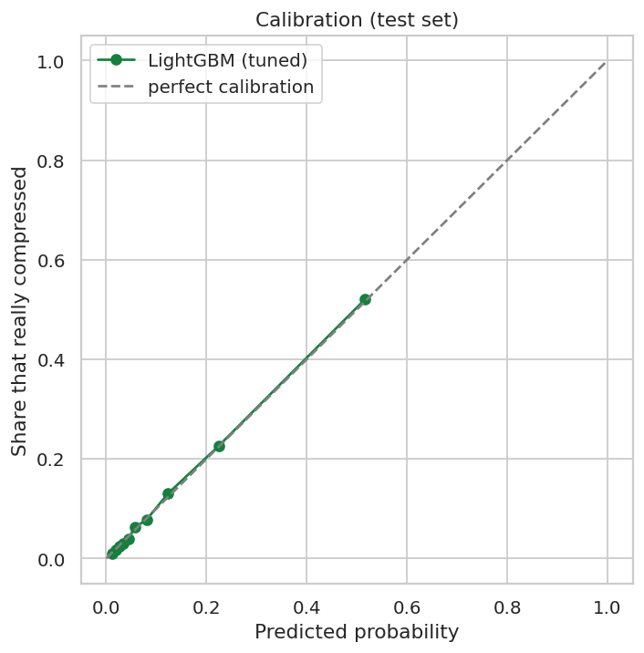
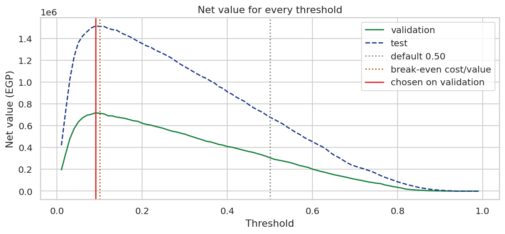
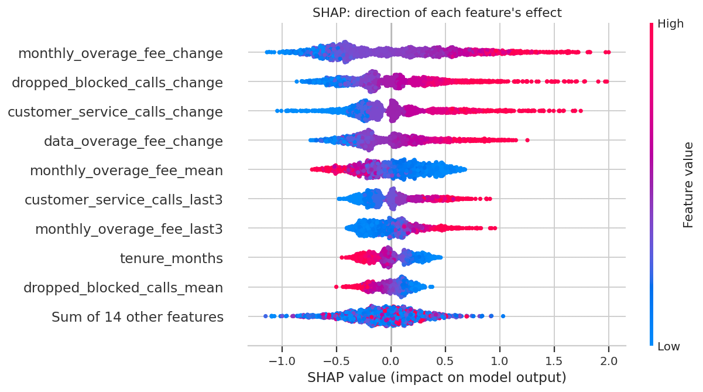

# Cost-Sensitive Prediction of Value Compression in Telecom

A complete, beginner-readable machine-learning pipeline that finds telecom customers who are **quietly cutting their spend** before they leave, then decides **whom to contact using the cost of being wrong**, not a default 0.50 cut-off.

> **Synthetic data, demonstration only.** All data in this repository is generated by `generate_panel_data.py`. It contains no information from any real company or customer. The relationships in it are **built into the generator**, so the results below show that the *method works end to end*. They are not evidence about any real customer base, and the money figures rest on stated assumptions.

---

## The idea

Most retention work reacts to customers who have already left. This project targets an earlier group: customers who are **still active but have started to give up**. After repeated problems (dropped calls, bill surprises, support contacts that do not fix anything) they do not leave straight away; they first **reduce what they spend**. A standard churn trigger never fires for them.

The project turns that idea into a testable pipeline:

1. Define *value compression* precisely: revenue over the last three months is **25% or more below** the three months before.
2. Check whether customers who are *about to* leave behave like customers who *already left* (a timeline comparison).
3. Build features from months 1–9, predict compression in months 10–12.
4. Choose the contact threshold from the **cost of an offer vs the value of a save**.
5. Export one reusable model file.

## What is in this repository

```
├── README.md                              this file
├── METHODOLOGY.md                         every step explained, with limits
├── generate_panel_data.py                 builds the synthetic data
├── 01_cleaning_and_exploration.ipynb      cleaning, target definition, timeline plots
├── 02_feature_engineering.ipynb           features from months 1-9, stratified split
├── 03_model_training_and_testing.ipynb    3 models, Optuna tuning, honest testing
├── 04_evaluation_and_export.ipynb         ROC, SHAP, cost-based threshold, joblib export
├── docs/figures/                          figures used below
├── requirements.txt
├── LICENSE
├── data/                                  created by the generator (not committed)
└── work/                                  created by the notebooks (not committed)
```

## Quickstart

```bash
git clone https://github.com/see0mar/cost-sensitive-telecom-retention.git
cd cost-sensitive-telecom-retention
python -m venv .venv && source .venv/bin/activate      # Windows: .venv\Scripts\activate
pip install -r requirements.txt

python generate_panel_data.py --validate               # creates data/ (generation ~2 s; --validate adds a data report)
jupyter notebook                                       # run notebooks 01 -> 04 in order
```

Each notebook saves files in `work/` for the next one, so run them **in order**. All four take about 2.5 minutes together on a laptop-class machine (most of it is Optuna in notebook 03).

*Google Colab / Kaggle:* each notebook has a two-line settings cell (`DATA_DIR`, `WORK_DIR`) and instructions. The local layout above is the tested path; the Colab and Kaggle settings are provided but not yet tested.

## The pipeline at a glance

| Notebook | Stage | Reads | Saves |
|---|---|---|---|
| 01 | Cleaning, analysis (target definition), visualizing | `data/*.parquet` | `work/labels.parquet`, `work/clean_customers.parquet` |
| 02 | Feature engineering, stratified split | data + notebook 01 files | `work/train / valid / test.parquet` |
| 03 | Model building, Optuna tuning, testing | split files | `work/trained_models.joblib` |
| 04 | Final visuals, SHAP, cost-based threshold, export | models + split files | `work/retention_model.joblib`, `work/test_predictions.parquet` |

Code style is deliberately plain: short cells, no custom classes, two tiny helper functions in total.

## What the synthetic run shows

*Values below come from the delivered data (seed 42). Other machines may differ in the last decimals.*

**Data:** 200,000 customers, 2,352,248 customer-month rows over 12 months. 175,571 customers are still active at month 12; **11.4%** of them are labelled *compressed* (about 7.8 normal customers for every compressed one).

**1. The timeline comparison.** Customers who end up compressed or churned show rising support calls, dropped calls and overage fees from about month 5, while normal customers stay flat.



*Honest note:* the generator gives all at-risk customers the same deterioration process, so this similarity is **built in**. On real data this same comparison is the actual test of the idea.

**2. Model comparison (test set, AUC).**

| Model | Test AUC |
|---|---|
| Decision tree (depth 4) | 0.770 |
| Logistic regression | 0.832 |
| LightGBM, default | 0.838 |
| **LightGBM, tuned with Optuna (20 trials)** | **0.841** |

LightGBM leads, but only slightly over logistic regression. On real data a near-equal simple model is often the better choice because it is easier to explain.



**3. Can the probabilities be trusted?** Predicted risk closely follows the share that really compressed, which is what the cost rule needs.



**4. The cost-based threshold.** With assumed economics of **500 EGP** saved per retained customer and **50 EGP** per offer, the break-even probability is 50 / 500 = 0.10. The threshold chosen on the *validation* set was **0.09**. Results on the *test* set (52,672 customers):

| Threshold | Flagged | Caught (TP) | Wasted (FP) | Missed (FN) | Net value (EGP) |
|---|---:|---:|---:|---:|---:|
| Default 0.50 | 2,523 | 1,610 | 913 | 4,387 | 678,850 |
| Break-even 0.10 | 15,360 | 4,560 | 10,800 | 1,437 | 1,512,000 |
| **Chosen on validation 0.09** | **16,695** | **4,700** | **11,995** | **1,297** | **1,515,250** |

The cost-based threshold gives about **2.2×** the net value of 0.50 (+836,400 EGP on this test set), at 28% precision and 78% recall.



> **The biggest caveat.** These figures assume **every flagged compressing customer is saved**. If only half accept the offer, net value falls to 340,250 EGP; at a quarter it is **negative (−247,250 EGP)**. A real deployment must first measure how often an offer works, for example with a held-out control group.

**5. Explaining the model.** The model leans most on the trend features (`_change` = late behaviour minus early behaviour), about 72% of total importance. An ablation in notebook 03 shows that removing them does **not** lower validation AUC, because the same information is in the other columns. Importance shows what a model *uses*, not what it *needs*.



## How this was checked

Every claim above was verified against the executed notebooks: all four run from scratch with no errors; the data regenerates identically from the seed; no revenue, answer-key, churn or segment column is used as a feature; train, validation and test share no customer; the label and the money figures were recomputed independently; and the saved joblib model reproduces its predictions exactly when loaded in a fresh Python process.

One known detail: revenue is stored as `float32`, so 1 of 200,000 customers sits on the −25% cut-off and can flip label with float64 arithmetic (0.0005%). It does not affect any result here.

## Limitations

- **Synthetic by construction:** results demonstrate the method, not real-world performance.
- **Assumed economics:** 500 EGP and 50 EGP are illustrative inputs; change them in notebook 04.
- **No causal claim:** the model predicts who will compress, not who will respond to an offer.
- **Not yet done:** test on an external public dataset, SQL examples, and a dashboard.

## Tested with

Python 3.12.3, pandas 3.0.2, numpy 2.4.4, scikit-learn 1.8.0, LightGBM 4.7.0, SHAP 0.54.1, Optuna 5.0.0, matplotlib 3.10.8, seaborn 0.13.2, pyarrow 26.0.1, joblib 1.5.3. A joblib file should be reloaded with the same library versions; the exported file stores them.

## Author and license

Omar ElTokhy · MIT License (see `LICENSE`).
<!-- If your NDA allows it, add an acknowledgement of the programme here. -->
